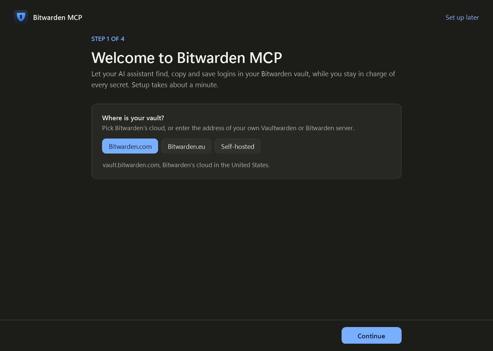
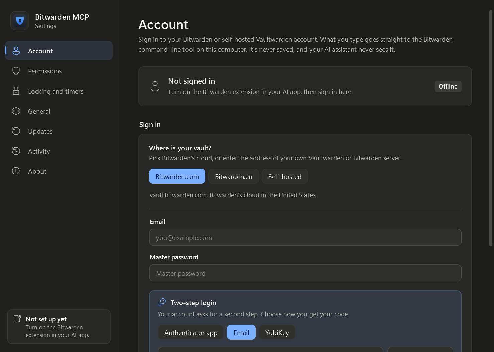
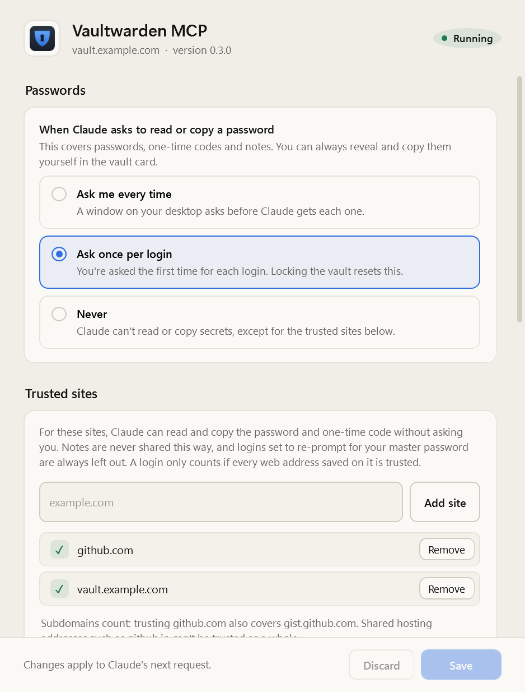
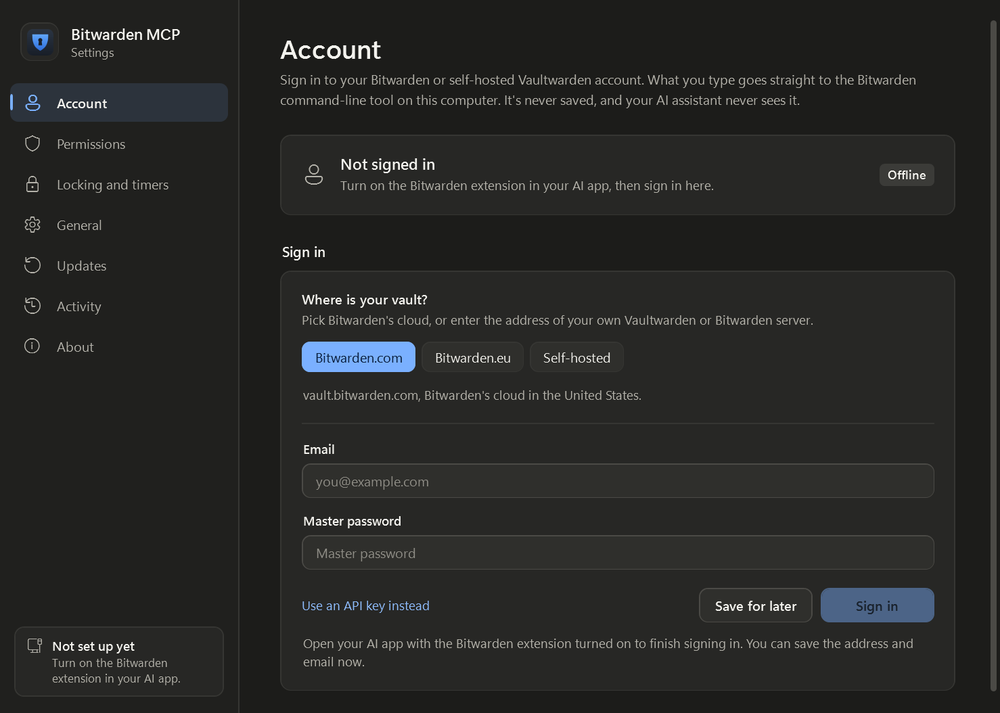
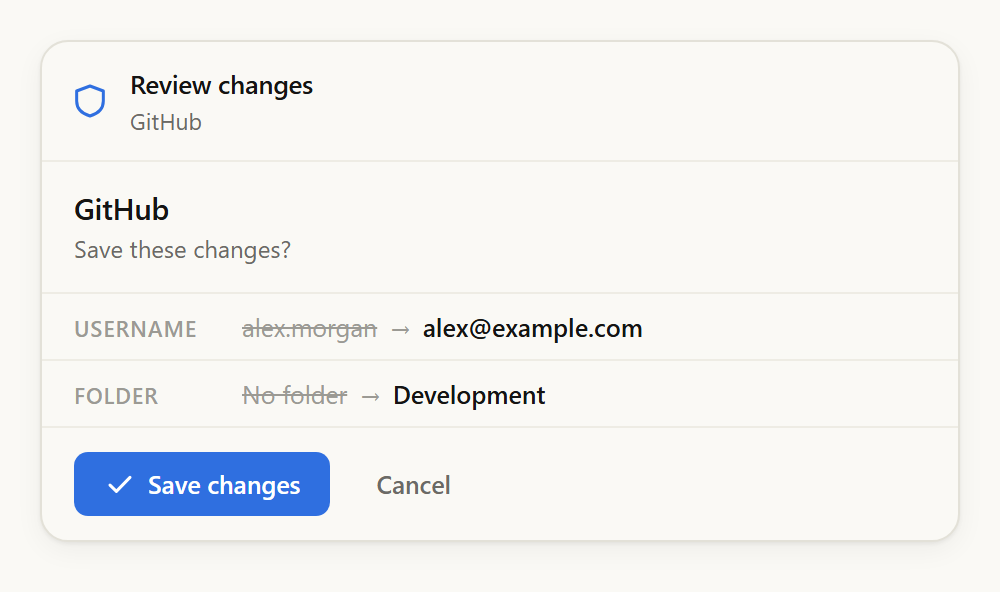

# Bitwarden MCP: use your password vault from your AI assistant

An [MCP](https://modelcontextprotocol.io) server that connects your AI assistant to your
[Bitwarden](https://bitwarden.com) vault, on bitwarden.com, bitwarden.eu or a self-hosted
[Vaultwarden](https://github.com/dani-garcia/vaultwarden). It runs the official
[Bitwarden CLI](https://bitwarden.com/help/cli/). Look up logins, copy passwords, and add or edit
entries from a chat.

You decide what the assistant can see. By default it never reads a password without asking you
first, and it can't change anything until you click Save.

[](https://github.com/ShadowsDistant/Vaultwarden-MCP/actions/workflows/ci.yml)
[](https://github.com/ShadowsDistant/Vaultwarden-MCP/releases/latest)
[](LICENSE)

<p align="center">
  
  
</p>

> Unofficial. Not affiliated with Bitwarden, Inc. or the Vaultwarden project. Read
> [SECURITY.md](SECURITY.md) before you point it at a vault you care about.

**Contents** · [Install (Windows + Claude Desktop)](#install-windows--claude-desktop) ·
[Other apps](#add-it-to-other-ai-apps) · [Settings app](#the-settings-app) ·
[Updates](#updates) · [What the assistant can do](#what-the-assistant-can-and-cant-do) ·
[Tools](#tools) · [Troubleshooting](#troubleshooting) · [Security](SECURITY.md)

## Install (Windows + Claude Desktop)

About two minutes. You don't need Node or anything else: it all comes in one file.

1. **Download** `vaultwarden-mcp-<version>.mcpb` from the
   [latest release](https://github.com/ShadowsDistant/Vaultwarden-MCP/releases/latest).
2. **Double-click it.** Claude Desktop opens an install window. Click **Install**. (If
   double-clicking does nothing, open Claude Desktop, go to **Settings → Extensions → Advanced
   settings → Install Extension…** and pick the file.)
3. **Sign in.** The **Bitwarden MCP Settings** window opens by itself the first time:
   - Pick where your vault is: **Bitwarden.com**, **Bitwarden.eu**, or **Self-hosted** (type the
     address you open in your browser, such as `https://vault.example.com`).
   - Enter your email and master password and click **Sign in**.
   - If your account uses two-step login, choose how you get codes (authenticator app, email or
     YubiKey) and enter the code.
   - Choose what the assistant may do. The defaults are safe.
4. **Start a new chat** and ask *"What's my GitHub login?"* or *"Make me a new password for
   Fastmail."*

To open the Settings app again later, use the **Bitwarden MCP Settings** shortcut (the app
offers to put one on your desktop and in the Start menu), or ask the assistant to *"open my vault
settings"*.

> **Never type your master password into a chat.** This server only asks for it in the Settings
> app or in its own desktop window. If anything asks for it in the conversation, it isn't this
> server.

<p align="center">
  
  
</p>

**Sign-in methods.** Email and master password, with or without two-step login by authenticator
app, email code or YubiKey (OTP). You can also sign in with your
[personal API key](https://bitwarden.com/help/personal-api-key/); use that if Bitwarden emails you
a *new device* verification code, or if your only second step is a passkey, Duo or a FIDO2 key.
Signing in *with* a passkey and "log in with device" aren't possible, because the Bitwarden CLI
doesn't support them.

## Add it to other AI apps

Any app that can start a local ("stdio") MCP server works: Claude Code, Cursor, VS Code,
Windsurf, Cline, Zed and others. These need [Node.js](https://nodejs.org) 20 or newer.

**1. Get the server files.** Download the same `.mcpb` from the
[latest release](https://github.com/ShadowsDistant/Vaultwarden-MCP/releases/latest), rename it to
end in `.zip`, and extract it to a folder you'll keep, such as `C:\bitwarden-mcp` or
`~/bitwarden-mcp`. (Or build from source: `git clone`, then `npm install --legacy-peer-deps` and
`npm run build`.)

**2. Add it to your app.** Below, replace `/path/to/bitwarden-mcp` with that folder. On Windows,
write paths in JSON with double backslashes: `C:\\bitwarden-mcp\\dist\\index.js`.

Most apps take this, in their MCP config file or settings:

```json
{
  "mcpServers": {
    "bitwarden": {
      "command": "node",
      "args": ["/path/to/bitwarden-mcp/dist/index.js"]
    }
  }
}
```

<details>
<summary><b>Claude Code</b></summary>

```bash
claude mcp add bitwarden --scope user -- node /path/to/bitwarden-mcp/dist/index.js
```

Run `/mcp` inside Claude Code to check it's connected.
</details>

<details>
<summary><b>Cursor</b></summary>

**Cursor Settings → MCP → Add new MCP server**, or put the JSON above in `~/.cursor/mcp.json`.
</details>

<details>
<summary><b>VS Code (Copilot agent mode)</b></summary>

Command Palette → **MCP: Add Server** → **Command (stdio)** → `node /path/to/bitwarden-mcp/dist/index.js`.
In a config file VS Code uses `"servers"` instead of `"mcpServers"`.
</details>

<details>
<summary><b>Windsurf</b></summary>

Add the JSON above to `~/.codeium/windsurf/mcp_config.json`.
</details>

<details>
<summary><b>Claude Desktop without the extension</b></summary>

**Settings → Developer → Edit Config**, add the JSON above, then quit Claude completely and
reopen it.
</details>

<details>
<summary><b>Windows: let a script do it</b></summary>

From a source checkout, `scripts\setup.ps1 -Install` builds everything (outside OneDrive),
registers it with Claude Desktop, and opens the Settings app. Add `-Client cursor` or
`-Client windsurf` for those apps. For anything else,
`node scripts\install.mjs --print` prints the exact entry to paste.
</details>

**3. Sign in.** Restart the app and ask it to *"unlock my vault"*. On Windows the Settings app
opens; elsewhere a sign-in window asks for your vault address, email and master password.

**Apps without cards.** Only some apps draw the inline vault card. Everywhere else the assistant
answers in plain text and asks you to confirm changes in a desktop window. Everything still works.

**Not supported:** AI apps that run only in a browser or on a phone. They can't start a program on
your computer, which this server needs.

## The Settings app

<p align="center">
  
  
</p>

A Windows app where you decide what the assistant may do. The assistant can't change any of it.
Changes apply to its next request, except turning cards on or off, which applies the next time
your AI app starts the extension.

| Page | What's there |
| --- | --- |
| **Account** | Where your vault is, sign in or out, unlock, lock now. |
| **Permissions** | When the assistant may read or copy a password, code or note: *ask every time* (default), *ask once per login*, or *never*. Trusted sites. Whether it may prepare new logins and edits, and separately whether it may move items to the trash. You confirm every change either way. |
| **Locking and timers** | Lock when your AI app closes (default), after a period of inactivity, or never. How long a revealed password stays on screen, and when a copied one leaves the clipboard. |
| **General** | Inline cards on or off, theme, animations. |
| **Updates** | Check for and install new versions. |
| **Activity** | Everything your AI assistant did with your vault, and when: searches, items it looked at, passwords and codes it read or copied (and whether you allowed it), changes it prepared and the ones you confirmed, sign-in and locking. Names the app, item and site, never usernames, passwords or codes. Filter, search, clear, or switch it off. Stored in `activity.jsonl` on this computer only. |
| **About** | Versions, shortcuts, the data folder. |

**Never lock** keeps the vault unlocked even after a restart, until you lock it yourself. The
session is stored encrypted so only your Windows account can use it, but anyone who can use your
Windows account can then use your vault without the master password. Pick it only on a computer
nobody else uses.

**Trusted sites.** For these sites the assistant can read and copy the password and one-time code
without asking. `github.com` also covers `gist.github.com`, but not `notgithub.com`. A login only
counts if *every* web address saved on it is trusted. Addresses shared by many unrelated sites,
such as `github.io`, are refused. Notes are never shared this way, and logins set to re-prompt for
your master password are always left out.

The app isn't code-signed, so the first time Windows may say *"Windows protected your PC"*. Click
**More info**, then **Run anyway**.

<details>
<summary><b>On macOS or Linux: edit the settings file</b></summary>

The same settings live in `~/.vaultwarden-mcp/settings.json`:

```json
{
  "access": "ask",
  "trustedSites": ["github.com"],
  "allowChanges": true,
  "allowTrash": true,
  "lockMode": "exit",
  "idleLockMinutes": 15,
  "cards": true,
  "updateCheck": true
}
```

`access` is `ask`, `session` (ask once per login) or `never`. `lockMode` is `exit`, `idle` (uses
`idleLockMinutes`) or `never` (Windows only; elsewhere it behaves like `exit`). If the file can't
be read, the server falls back to its strictest settings until you fix it.
</details>

## Updates

The server and the Settings app check GitHub for a new release every few hours. (Turn this off on
the Updates page. Nothing about you is sent; it's a plain request for the latest version number.)

When there's a new version you'll hear about it however you use the extension: a banner on the
vault card, a note from the assistant in chat, and a banner in the Settings app. Click **Update**
on the Settings app's Updates page. It downloads the new `.mcpb`, checks it against the release's
checksums, and opens it, so Claude Desktop asks you to confirm. Manual installs get a link to the
release instead.

## What the assistant can and can't do

| It can | It can't |
| --- | --- |
| Search the vault and list folders | Read a password, one-time code or note, unless your settings allow it |
| See item names, usernames and sites | Create, edit or trash anything until you press Save or confirm in a window |
| Copy a password to your clipboard without seeing it, if your settings allow it | Delete for good. Deletes go to the trash, where your server keeps them 30 days |
| Generate a password that only you see | Change which vault it talks to, or change its own settings |
| Prepare changes for you to confirm | See your master password, two-step codes or API key |

<p align="center">
  
  
  
</p>

**In the card,** *Reveal* shows a secret for 30 seconds, then hides it. *Copy* never displays it:
the server writes it straight to your clipboard and clears it 30 seconds later, tagged so Windows
clipboard history and cloud clipboard skip it. Logins flagged "master password re-prompt" ask for
your password again first.

## Compatibility

| | |
| --- | --- |
| **Vault** | Bitwarden.com, Bitwarden.eu, self-hosted Bitwarden, Vaultwarden 1.37.2 or newer. |
| **Windows** | Full support, including the Settings app. |
| **macOS** | Works. Sign in through the desktop window; settings are in `settings.json`. |
| **Linux** | Needs `zenity` or `kdialog` for windows. Settings are in `settings.json`. |
| **Node** | Not needed for the Claude Desktop extension. Other apps: 20 or newer. The Bitwarden CLI is bundled. |

## Tools

⧉ marks the tools that draw a card when the app supports it.

| Tool | What it does |
| --- | --- |
| `vault_status` ⧉ | Signed in, locked or unlocked, and what the assistant is allowed to do |
| `vault_login` ⧉ | Sign in: opens the Settings app on Windows, a window elsewhere |
| `vault_unlock` ⧉ | Unlock, in a window on your desktop |
| `vault_lock` | Lock immediately |
| `vault_sync` | Pull the latest contents from the server |
| `vault_search` ⧉ | Find items by name, site or folder. Names and sites only |
| `vault_get_item` ⧉ | One item, minus every secret |
| `vault_list_folders` | The folders |
| `vault_copy_secret` | Copy a password, code or note to your clipboard. The assistant never sees it |
| `vault_reveal_secret` | Read one secret into the chat, when your settings allow it |
| `vault_generate_password` ⧉ | Generate a password or passphrase that only you see |
| `vault_create_login` ⧉ | Prepare a new login for you to save |
| `vault_edit_item` ⧉ | Prepare a change for you to confirm |
| `vault_trash_item` ⧉ | Prepare to move an item to the trash |
| `vault_restore_item` ⧉ | Bring an item back out of the trash |
| `vault_open_settings` | Open the Settings app |

## Troubleshooting

**The assistant says it isn't allowed to read passwords.** That's the *Never* setting, or a
settings file that couldn't be read. Check **Permissions** in the Settings app.

**The Settings app says the extension isn't running.** Open your AI app (the extension starts
with it), then try again. You can still save your vault address and email beforehand.

**"Code is required" / Bitwarden emailed me a new-device code.** The Bitwarden CLI can't accept
new-device codes. Sign in with your personal API key instead (the link is under the sign-in form).

**No window appears when unlocking.** Look behind other windows. On Linux, install `zenity` or
`kdialog`. Otherwise check `~/.vaultwarden-mcp/logs/server.log`.

**"Could not reach the vault server."** Check the address and that your vault is up. For a private
certificate authority, set `VW_MCP_CA_FILE` (below).

**The assistant said an item was created but it isn't there.** It was a draft. Drafts are saved
only when you press Save, or say yes in the window.

**I turned cards off and nothing changed.** Quit your AI app completely and reopen it.

**The vault keeps locking.** **Locking and timers** → *When my AI app closes*.

## Advanced: environment variables

Set these under `env` in your app's MCP config. You normally need none of them.

| Variable | What it does |
| --- | --- |
| `VW_MCP_SERVER_URL` | Pin the vault address. When set, it can't be changed from the Settings app. Never settable from a chat. |
| `VW_MCP_EMAIL` | Pre-fills sign-in. |
| `VW_MCP_HOME` | Where settings, the CLI's data and the log live. Default `~/.vaultwarden-mcp`. |
| `VW_MCP_CA_FILE` | A CA bundle, for a vault behind a private certificate authority. |
| `VW_MCP_ALLOW_HTTP` | Allow a plain `http://` address for a host other than localhost. |
| `VW_MCP_UPDATE_CHECK` | `0` to switch update checks off (the settings file wins). |
| `BW_SESSION` | An already-unlocked session, for a machine with no desktop to show a window on. |

The older `VW_MCP_IDLE_LOCK_MIN`, `VW_MCP_MODEL_REVEAL`, `VW_MCP_REVEAL_SECONDS`,
`VW_MCP_CLIPBOARD_CLEAR_SECONDS`, `VW_MCP_TRUSTED_SITES`, `VW_MCP_READ_ONLY` and `VW_MCP_CARDS`
still work. Anything in `settings.json` wins over them.

## Development

```bash
npm install --legacy-peer-deps
npm run build      # tsc, then bundle the card into one HTML file
npm test           # end-to-end tests against a fake Bitwarden CLI, over real stdio
npm run settings   # build the Windows Settings app and run its self-test
npm run preview    # card views at http://localhost:8766
npm run pack       # build the .mcpb extension bundle
```

No test touches a real vault. `test/fake-bw/bw.js` stands in for the CLI, and the server runs as a
real child process driven by the MCP SDK client. The most important test plants a marker string in
every secret and fails if it appears anywhere a model could read it.

```
src/index.ts          startup, instructions to the model, shutdown
src/settings.ts       settings.json: loading, hot reload, trusted-site rules
src/policy.ts         when the assistant may have a secret
src/tools.ts          the tool surface
src/session.ts        the session key, sign-in, unlock, lock modes
src/shared-session.ts one unlock shared by every server process (Windows, DPAPI)
src/ipc.ts            the Settings app's channel for signing in
src/noderun.ts        runs the CLI as a child process, or in a worker inside Claude Desktop
src/updates.ts        release checks
src/settingsapp.ts    finding, updating and opening the Settings app
src/vault.ts          item operations, and what the model and the card each see
src/bw.ts             Bitwarden CLI wrapper
src/sanitize.ts       the untrusted-text screen
src/pending.ts        staged changes and generated passwords waiting for the card
src/prompt.ts         desktop windows
src/clipboard.ts      copy, and the clear that only fires if the value is still there
ui/                   the card
settings-app/         the Windows Settings app (C#, WPF)
scripts/              build, install, package, window, clipboard and DPAPI helpers
test/                 unit and end-to-end tests, the fake CLI and window
```

## Licence

Copyright (C) 2026 ShadowsDistant.

This program is free software: you can redistribute it and modify it under the terms of the GNU
General Public License as published by the Free Software Foundation, either version 3 of the
License, or (at your option) any later version. It is distributed without any warranty, without
even the implied warranty of merchantability or fitness for a particular purpose. See the
[GNU General Public License](LICENSE) for details.

The bundled Bitwarden CLI is redistributed under [its own terms](https://github.com/bitwarden/clients).
Bitwarden is a trademark of Bitwarden, Inc.; this project is not endorsed by it.
