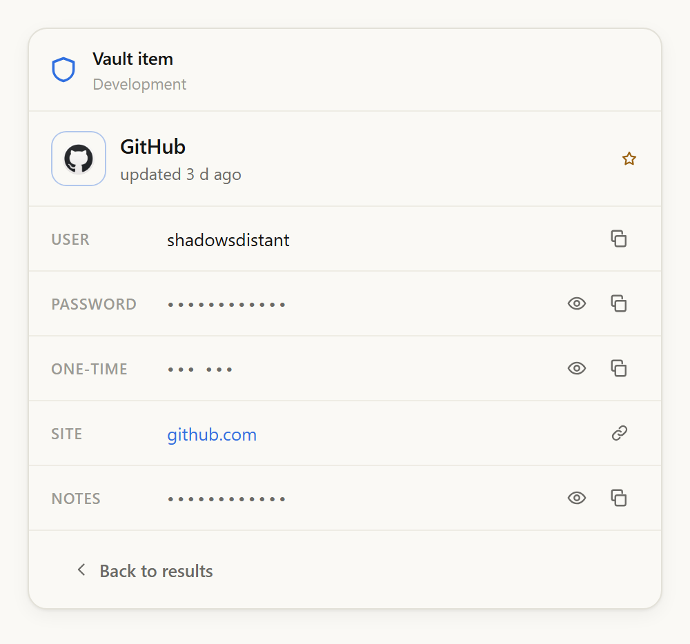
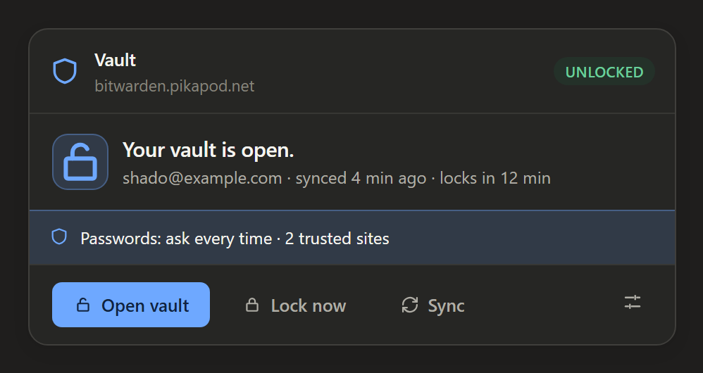
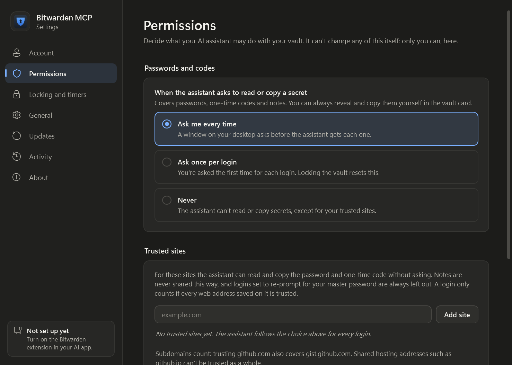
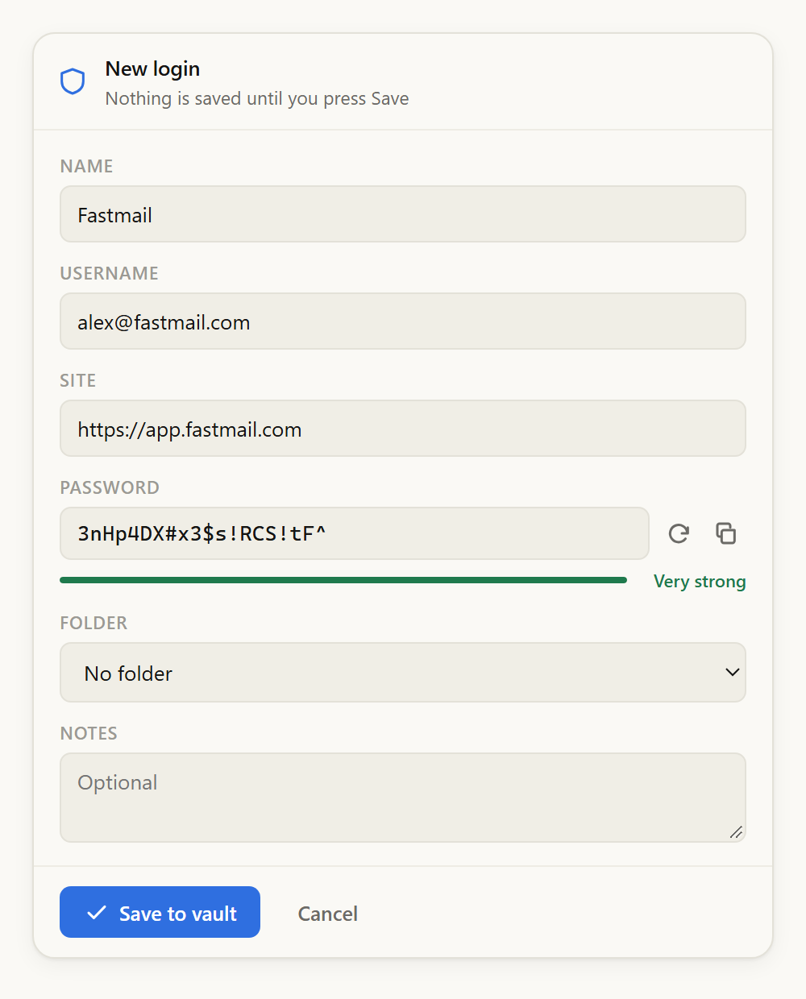
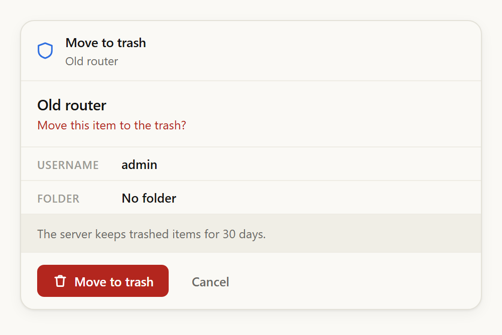

# Vaultwarden MCP: connect Claude to your self-hosted password vault

An [MCP](https://modelcontextprotocol.io) server that connects Claude to a self-hosted
[Vaultwarden](https://github.com/dani-garcia/vaultwarden) or Bitwarden vault through the official
[Bitwarden CLI](https://bitwarden.com/help/cli/). Look up logins, copy passwords, add new ones and
edit old ones from a chat.

You decide what Claude can see. By default it never reads a password without asking you first, and
it can't change anything until you click Save.

[](https://github.com/ShadowsDistant/Vaultwarden-MCP/actions/workflows/ci.yml)
[](https://github.com/ShadowsDistant/Vaultwarden-MCP/releases/latest)
[](LICENSE)

<p align="center">
  
  
</p>

> Not affiliated with Bitwarden or Vaultwarden. This is a personal project built on the published
> Bitwarden CLI. Read [SECURITY.md](SECURITY.md) before pointing it at a vault you care about.

**Contents** · [Install in Claude Desktop](#install-in-claude-desktop) ·
[Other apps](#add-it-to-other-apps) · [Settings app](#the-settings-app) ·
[What Claude can do](#what-claude-can-and-cant-do) · [Tools](#tools) ·
[Troubleshooting](#troubleshooting) · [Security](SECURITY.md)

## Install in Claude Desktop

This takes about two minutes. You don't need to install Node or anything else; everything comes
in one file.

**You need:** [Claude Desktop](https://claude.ai/download) and the web address of your vault (the
one you open in a browser, such as `https://vault.example.com`).

1. **Download** `vaultwarden-mcp-<version>.mcpb` from the
   [latest release](https://github.com/ShadowsDistant/Vaultwarden-MCP/releases/latest).
2. **Install it.** Double-click the file. If that doesn't open Claude, open Claude Desktop and go
   to **Settings → Extensions → Advanced settings → Install Extension…**, then pick the file.
3. **Enter your vault address** when Claude asks for it. The email field is optional; it only
   pre-fills the sign-in window. Click **Install**.
4. **Start a new chat** and type *"Unlock my vault."* A window opens on your desktop (not in the
   chat). Type your master password there, plus your two-step code if you use one.
5. **Try it.** *"What's my GitHub login?"* or *"Make me a new password for Fastmail."*

That's it. The vault locks again when you quit Claude.

> **Never type your master password into the chat.** This server only ever asks for it in its
> own desktop window. If anything asks for it in the conversation, it isn't this server.

## Add it to other apps

Any app that can run a local ("stdio") MCP server can use this. These need
[Node.js](https://nodejs.org) 20 or newer, and a copy of the server on your computer.

**Get the server files** (pick one):

- **Easiest:** download the same `.mcpb` file from the
  [latest release](https://github.com/ShadowsDistant/Vaultwarden-MCP/releases/latest), rename it
  to end in `.zip`, and extract it to a folder you'll keep, such as `C:\vaultwarden-mcp` or
  `~/vaultwarden-mcp`. It already contains everything it needs.
- **From source:**
  ```bash
  git clone https://github.com/ShadowsDistant/Vaultwarden-MCP.git
  cd Vaultwarden-MCP
  npm install --legacy-peer-deps
  npm run build
  ```

In the examples below, replace `/path/to/vaultwarden-mcp` with that folder and
`https://vault.example.com` with your vault. On Windows, write paths with double backslashes
inside JSON: `C:\\vaultwarden-mcp\\dist\\index.js`.

<details>
<summary><b>Claude Desktop (manual setup instead of the extension)</b></summary>

Open **Settings → Developer → Edit Config**. That opens `claude_desktop_config.json`. Add this,
save, then quit Claude completely and reopen it:

```json
{
  "mcpServers": {
    "vaultwarden": {
      "command": "node",
      "args": ["/path/to/vaultwarden-mcp/dist/index.js"],
      "env": { "VW_MCP_SERVER_URL": "https://vault.example.com" }
    }
  }
}
```

On Windows, `scripts\setup.ps1 -Install -Server https://vault.example.com` does all of this for
you from a source checkout, including building the Settings app.
</details>

<details>
<summary><b>Claude Code</b></summary>

```bash
claude mcp add vaultwarden --scope user --env VW_MCP_SERVER_URL=https://vault.example.com -- node /path/to/vaultwarden-mcp/dist/index.js
```

Then run `/mcp` inside Claude Code to check it's connected. Claude Code shows the vault cards too.
</details>

<details>
<summary><b>Cursor</b></summary>

Add a new MCP server from the MCP section of **Cursor Settings**, or edit `~/.cursor/mcp.json`
directly:

```json
{
  "mcpServers": {
    "vaultwarden": {
      "type": "stdio",
      "command": "node",
      "args": ["/path/to/vaultwarden-mcp/dist/index.js"],
      "env": { "VW_MCP_SERVER_URL": "https://vault.example.com" }
    }
  }
}
```
</details>

<details>
<summary><b>VS Code (GitHub Copilot agent mode)</b></summary>

Open the Command Palette, run **MCP: Add Server**, choose **Command (stdio)**, and enter
`node /path/to/vaultwarden-mcp/dist/index.js`. Or run **MCP: Open User Configuration** and add:

```json
{
  "servers": {
    "vaultwarden": {
      "type": "stdio",
      "command": "node",
      "args": ["/path/to/vaultwarden-mcp/dist/index.js"],
      "env": { "VW_MCP_SERVER_URL": "https://vault.example.com" }
    }
  }
}
```
</details>

<details>
<summary><b>Windsurf, Cline, and anything else</b></summary>

Most apps use the same shape as Claude Desktop: a `mcpServers` object with `command`, `args` and
`env`. Windsurf keeps it in `~/.codeium/windsurf/mcp_config.json`.
</details>

**Apps without cards.** Only some apps can draw the inline vault card. Everywhere else, Claude
answers in plain text and asks you to confirm changes in a desktop window. Everything still works.

**Not supported:** claude.ai in a browser and the Claude mobile apps. They can't start a program
on your computer, which this server needs.

## The Settings app

<p align="center">
  
  
</p>

A small Windows app where you decide what Claude is allowed to do. Claude can't change any of it.
Changes apply to Claude's next request, except turning cards on or off, which needs a restart of
Claude.

**To open it**, do any one of these:

- Ask Claude: *"Open my vault settings."*
- Click the sliders button on the vault card.
- Download `Vaultwarden-MCP-Settings.exe` from the
  [latest release](https://github.com/ShadowsDistant/Vaultwarden-MCP/releases/latest) and run it.
  It finds your settings on its own.

The app isn't code-signed, so the first time Windows may say *"Windows protected your PC"*. Click
**More info**, then **Run anyway**.

| Setting | What it does |
| --- | --- |
| **When Claude asks for a password** | *Ask me every time* (default): a desktop window asks before Claude gets each password, code or note. *Ask once per login*: asked the first time per login, until the vault locks. *Never*: Claude can't read or copy any, except for trusted sites. |
| **Trusted sites** | Claude reads and copies the password and one-time code for these sites without asking. Notes are never shared this way, and logins set to re-prompt for your master password are always left out. |
| **Show vault cards** | Turn off to keep Claude to plain text. Changes are then confirmed in desktop windows. |
| **Let Claude prepare changes** | Turn off and Claude can only look. With it on, you still confirm every change. |
| **Lock the vault** | Only when Claude closes (default), or also after 5 minutes to 4 hours of no vault activity. |
| **Timers** | How long a revealed password stays on screen, and when a copied one is cleared from the clipboard. |

**How trusted sites match.** `github.com` also covers `gist.github.com`, but not
`notgithub.com` or `github.com.evil.example`. A login counts only if *every* web address saved on
it is trusted. Addresses shared by many unrelated sites, such as `github.io` or `co.uk`, are
refused. Only trust sites whose passwords you'd be comfortable having in a chat transcript.

<details>
<summary><b>On macOS or Linux: edit the settings file</b></summary>

The same settings live in `~/.vaultwarden-mcp/settings.json`. Create it if it isn't there:

```json
{
  "access": "ask",
  "trustedSites": ["github.com"],
  "cards": true,
  "allowChanges": true,
  "idleLockMinutes": 0,
  "revealSeconds": 30,
  "clipboardClearSeconds": 30
}
```

`access` is `ask`, `session` (ask once per login) or `never`. If the file can't be read, the
server falls back to its strictest settings (no secrets for Claude, no changes) until you fix it.
</details>

## What Claude can and can't do

Ask for a login and a card appears beside the reply, with the password hidden and a copy button
next to it. Ask for a new one and you get a filled-in draft with a generated password that saves
when you press Save, and not before.

| Claude can | Claude can't |
| --- | --- |
| Search the vault and list folders | Read a password, one-time code or note, unless your settings allow it |
| See item names, usernames and sites | Create, edit or trash anything until you press Save or confirm in a window |
| Copy a password to your clipboard without seeing it, if your settings allow it | Delete for good. Deletes go to the trash, where your server keeps them 30 days |
| Generate a password that only you see | Change which vault it talks to, or change its own settings |
| Prepare changes for you to confirm | See your master password. You type it into a desktop window |

<p align="center">
  
  
  
</p>

**In the card,** *Reveal* shows a secret for 30 seconds, then hides it. *Copy* never displays it:
the server writes it straight to your clipboard and clears it 30 seconds later, tagged so Windows
clipboard history and cloud clipboard skip it. Logins you flagged "master password re-prompt" ask
for your password again first. Site icons come from your own vault's icon service, the same one
the web vault uses.

[SECURITY.md](SECURITY.md) explains why each line is drawn where it is.

## Compatibility

| | |
| --- | --- |
| **Vault** | Vaultwarden 1.37.2 or newer, or Bitwarden's hosted service. |
| **Windows** | Full support, including the Settings app. |
| **macOS** | Full support. Settings are edited in `settings.json`. |
| **Linux** | Needs `zenity` or `kdialog` for the sign-in window. Settings are edited in `settings.json`. |
| **Node** | Only for apps other than the Claude Desktop extension: 20 or newer. The Bitwarden CLI is bundled. |
| **Cards** | Claude Desktop and Claude Code. Other apps get plain text and desktop windows. |

## Tools

⧉ marks the tools that draw a card when the app supports it.

| Tool | What it does |
| --- | --- |
| `vault_status` ⧉ | Whether the vault is signed in, locked or unlocked, and what Claude is allowed to do |
| `vault_login` ⧉ | Sign in, in a window on your desktop |
| `vault_unlock` ⧉ | Unlock, in a window on your desktop, then show the vault |
| `vault_lock` | Lock immediately and forget the session key |
| `vault_sync` | Pull the latest contents from the server |
| `vault_search` ⧉ | Find items by name, site or folder. Names and sites only, no usernames in bulk |
| `vault_get_item` ⧉ | One item, minus every secret |
| `vault_list_folders` | The folders, with the ids used to file or filter |
| `vault_copy_secret` | Copy a password, code or note to your clipboard. Claude never sees it |
| `vault_reveal_secret` | Read one secret into the chat, when your settings allow it |
| `vault_generate_password` ⧉ | Generate a password or passphrase that only you see |
| `vault_create_login` ⧉ | Prepare a new login for you to save |
| `vault_edit_item` ⧉ | Prepare a change for you to confirm, shown as before and after |
| `vault_trash_item` ⧉ | Prepare to move an item to the trash, for you to confirm |
| `vault_restore_item` ⧉ | Bring an item back out of the trash |
| `vault_open_settings` | Open the Settings app on your desktop |

The card has its own set of tools for reading a secret on a click, copying, and saving a draft.
They're marked app-only, and they're only switched on when the app says it can draw cards, so
nowhere else can call them.

## Troubleshooting

**Claude says it isn't allowed to read passwords.** That's the *Never* setting, or a settings file
that couldn't be read. Open the Settings app and check *When Claude asks for a password*.

**No window appears when unlocking.** Look behind other windows first. On Linux, install `zenity`
or `kdialog`. Otherwise check `~/.vaultwarden-mcp/logs/server.log`.

**"Could not reach the vault server."** Check the address and that your vault is up. If it uses a
private certificate authority, set `VW_MCP_CA_FILE` (see below).

**Claude says an item was created but it isn't there.** It was a draft. Drafts are saved only when
you press Save, or say yes in the window.

**I turned cards off (or on) and nothing changed.** Quit Claude completely and reopen it. That's
the one setting that needs a restart.

**Windows blocked the Settings app.** Click **More info**, then **Run anyway**. It's unsigned, not
unsafe; the source is in [`settings-app/`](settings-app).

**The vault keeps locking.** Set *Lock the vault* to *Only when Claude closes* in the Settings app.

## Advanced: environment variables

Set these in your app's MCP config under `env`. The Claude Desktop extension asks for the first
two when you install it.

| Variable | What it does |
| --- | --- |
| `VW_MCP_SERVER_URL` | Your vault address. Required. Deliberately not settable from a chat. |
| `VW_MCP_EMAIL` | Pre-fills the sign-in window. |
| `VW_MCP_HOME` | Where settings, the CLI's data and the log live. Default `~/.vaultwarden-mcp`. |
| `VW_MCP_CA_FILE` | A CA bundle, for a vault behind a private certificate authority. |
| `VW_MCP_ALLOW_HTTP` | Allow a plain `http://` address for a host other than localhost. |
| `BW_SESSION` | An already-unlocked session, for a machine with no desktop to show a window on. |

The older `VW_MCP_IDLE_LOCK_MIN`, `VW_MCP_MODEL_REVEAL`, `VW_MCP_REVEAL_SECONDS`,
`VW_MCP_CLIPBOARD_CLEAR_SECONDS`, `VW_MCP_TRUSTED_SITES`, `VW_MCP_READ_ONLY` and `VW_MCP_CARDS`
still work. Anything set in `settings.json` wins over them.

## Development

```bash
npm install --legacy-peer-deps
npm run build      # tsc, then bundle the card into one HTML file
npm test           # 121 tests against a fake Bitwarden CLI, over real stdio
npm run settings   # build the Windows Settings app and run its self-test
npm run preview    # card views at http://localhost:8766
npm run pack       # build the .mcpb extension bundle
```

No test touches a real vault. `test/fake-bw/bw.js` stands in for the CLI, and the server runs as
a real child process driven by the MCP SDK client. The most important test plants a marker string
in every secret and fails if it appears anywhere a model could read it.

```
src/index.ts        startup, instructions to the model, shutdown
src/settings.ts     settings.json: loading, hot reload, trusted-site rules
src/policy.ts       when Claude may have a secret
src/tools.ts        the tool surface
src/session.ts      the session key, sign-in, unlock, auto-lock
src/vault.ts        item operations, and what the model and the card each see
src/bw.ts           Bitwarden CLI wrapper
src/sanitize.ts     the untrusted-text screen
src/pending.ts      staged changes and generated passwords waiting for the card
src/prompt.ts       desktop windows
src/clipboard.ts    copy, and the clear that only fires if the value is still there
ui/                 the card
settings-app/       the Windows Settings app (C#, WPF)
scripts/            build, install, package, window and clipboard helpers
test/               unit and end-to-end tests, the fake CLI and window
```

## Licence

Copyright (C) 2026 ShadowsDistant.

This program is free software: you can redistribute it and modify it under the terms of the GNU
General Public License as published by the Free Software Foundation, either version 3 of the
License, or (at your option) any later version. It is distributed without any warranty, without
even the implied warranty of merchantability or fitness for a particular purpose. See the
[GNU General Public License](LICENSE) for details.

The bundled Bitwarden CLI is redistributed under [its own terms](https://github.com/bitwarden/clients).
